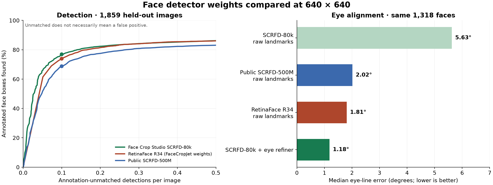

# Face detector comparison — 12 October 2026

Weights were evaluated locally; FaceCropJet was neither installed nor executed. Its exact extracted RetinaFace ResNet-34 weights were tested using the upstream reference preprocessing and decoder. This measures model performance, not the two finished applications.

## What the evidence supports

SCRFD-80k is competitive with RetinaFace R34 on this held-out domain, while its weights are about 35 times smaller and it runs about 9.5 times faster at the compared CPU operating points. SCRFD-80k plus the eye refiner gives lower paired eye-line error than RetinaFace's native landmarks.

**The detector ranking is provisional.** A visual spot-check of 20 randomly sampled unmatched detections per model found many genuine faces missing from the ground truth, and some real faces whose boxes narrowly fail the overlap cutoff. The table compares equal **annotation-mismatch budgets**, not human-verified false-positive rates. This was a spot-check, not a fully adjudicated new dataset. The underlying photographs, review sheets and per-image detections are not bundled with this document.

## Conditions

- 1,859 existing held-out Open Images validation/test photographs; 4,597 face annotations and 82 group/depiction ignore regions.
- 640 × 640 top-left letterboxing, each model’s native colour normalization, NMS 0.4, proposal floor 0.02.
- One-to-one score-ordered matching at box IoU ≥ 0.5. Unmatched detections overlapping an ignore region at IoU > 0.3 are excluded.
- Confidence scores are not calibrated across models. Each operating point below allows at most 0.1 unmatched detections per image; the thresholds were selected on this same set for descriptive comparison, not independent tuning.
- AMD Ryzen 9 7950X, WSL, ONNX Runtime 1.30.0 CPU provider, four inference threads. Timing includes resize, inference and decoding; excludes file reading. Same 48 images, two passes, five warmups. GPU/app throughput is not measured.

## At 0.1 unmatched detections per image

| Model | Threshold | Face recall | Unmatched/image | Median CPU time | Weight size |
|---|---:|---:|---:|---:|---:|
| Face Crop Studio SCRFD-80k | 0.4851 | 76.9% | 0.100 | 12.2 ms | 2.55 MB |
| RetinaFace R34 (FaceCropJet weights) | 0.9807 | 73.9% | 0.100 | 115.6 ms | 88.50 MB |
| Public SCRFD-500M | 0.6415 | 68.8% | 0.100 | 11.2 ms | 2.52 MB |

## Sensitivity to the annotation-mismatch budget

| Model | 0.05/image | 0.1/image | 0.2/image | 0.5/image |
|---|---:|---:|---:|---:|
| Face Crop Studio SCRFD-80k | 66.0% | 76.9% | 82.4% | 86.2% |
| RetinaFace R34 (FaceCropJet weights) | 61.1% | 73.9% | 81.4% | 86.1% |
| Public SCRFD-500M | 51.2% | 68.8% | 77.5% | 83.1% |

## At the same numeric threshold, 0.5

Scores are not calibrated across models, so these are different operating points. This shows why the mismatch-budget comparison should not be read as RetinaFace detecting fewer faces at its normal settings.

| Model | Annotated face recall | Unmatched/image |
|---|---:|---:|
| Face Crop Studio SCRFD-80k | 76.0% | 0.097 |
| RetinaFace R34 (FaceCropJet weights) | 85.3% | 0.371 |
| Public SCRFD-500M | 77.6% | 0.201 |

## Face size at the 640-pixel input

| Model | <16 px | 16–32 px | 32–64 px | 64–128 px | ≥128 px |
|---|---:|---:|---:|---:|---:|
| Face Crop Studio SCRFD-80k | 9.0% | 52.1% | 81.0% | 88.1% | 86.2% |
| RetinaFace R34 (FaceCropJet weights) | 5.9% | 44.3% | 77.3% | 86.8% | 85.2% |
| Public SCRFD-500M | 13.1% | 52.0% | 73.6% | 78.7% | 70.6% |

## Eye alignment

Paired on the same 1,318 side-known, manually clicked faces that all three detectors found at their selected thresholds. The refiner receives actual detected boxes. Eye distance is normalized by ground-truth box width.

| Pipeline | Median angle error | 90th percentile | Within 5° | Median eye distance / box width |
|---|---:|---:|---:|---:|
| Face Crop Studio SCRFD-80k raw landmarks | 5.63° | 20.29° | 46.4% | 0.112 |
| RetinaFace R34 (FaceCropJet weights) raw landmarks | 1.81° | 5.74° | 86.9% | 0.025 |
| Public SCRFD-500M raw landmarks | 2.02° | 6.74° | 83.2% | 0.028 |
| SCRFD-80k + eye refiner | 1.18° | 3.80° | 94.1% | 0.019 |
| RetinaFace + Face Crop Studio eye refiner (experiment) | 1.17° | 3.95° | 93.8% | 0.018 |

The eye refiner took a median 1.49 ms per face, including the crop. This is additional to detection time.

## Limits and interpretation

Open Images is the SCRFD-80k training-data source, although these images are held out. That domain match can favour SCRFD-80k. No independent labelled corpus was available in this run. Image-ID checks confirmed zero overlap with both the SCRFD-80k 80,000-image detector training manifest and the 2,482-image eye-label training set; this does not rule out near-duplicate photographs.

Open Images does not label every real face. “Unmatched” is an annotation-based upper bound on false positives: it also includes genuine unlabelled faces and plausible boxes failing the 0.5 overlap test. Do not interpret it as a human-verified error count.

The [older training notes](../tools/dataset/SCRFD_80K.md) evaluated only images with usable clicked eyes and allowed one detection to cover multiple ground-truth boxes. This evaluation includes every test image and requires one-to-one matches, so the absolute figures are not directly interchangeable.

This does not reproduce FaceCropJet’s complete preprocessing, chosen input resolution, confidence settings, PDF/photo-boundary detection, crop logic or DirectML execution. It tests its detector weights under controlled settings.

A credible broader claim needs an independently labelled set containing ordinary portraits, rotated images, low light, crowds, scans and faceless negatives, with thresholds frozen before scoring.

## Model identity and sources

The RetinaFace checkpoint extracted from FaceCropJet v2.0.2 was byte-identical to the
published [UniFace RetinaFace R34 weights](https://huggingface.co/yakhyo/uniface-weights/blob/main/retinaface_r34.onnx).
The [public SCRFD checkpoint](https://huggingface.co/yakhyo/uniface-weights/blob/main/scrfd_500m.onnx) came from the same mirror. The local SCRFD-80k and eye-refiner
exports were the models used by this project at the time of the run.

SHA-256 hashes:

- **SCRFD-80k:** `2437def9510f2af6431a5b2090ae9f357bc189cb0223be1b6c4d4ff085798e64`
- **RetinaFace R34:** `bd0263dc2a465d32859555cb1741f2d98991eb0053696e8ee33fec583d30e630`
- **Public SCRFD-500M:** `5e4447f50245bbd7966bd6c0fa52938c61474a04ec7def48753668a9d8b4ea3a`
- **Eye refiner:** `16b4ed6e42889c0eb3d6ce5068e399c19f12ad686bd121bcf959db34f8cef976`

Preprocessing and box decoding followed the
[InsightFace SCRFD reference](https://github.com/deepinsight/insightface/blob/master/detection/scrfd/tools/scrfd.py)
and [UniFace RetinaFace reference](https://github.com/yakhyo/uniface/blob/main/uniface/detection/retinaface.py).
The RetinaFace benchmark implementation was checked against the upstream methods on three
images; box matching, suppression and the mismatch-budget cutoff also passed self-checks.

This document records the local run rather than providing a bundled benchmark suite.
The repository's [dataset tools](../tools/dataset/) and
[training notes](../tools/dataset/SCRFD_80K.md) describe the held-out data and annotation format.
Timing results here use ONNX Runtime to compare weights under equal conditions; see the
[engine measurements](ENGINE_SPEED.md) for the separate historical Rust/WGSL runtime study.
