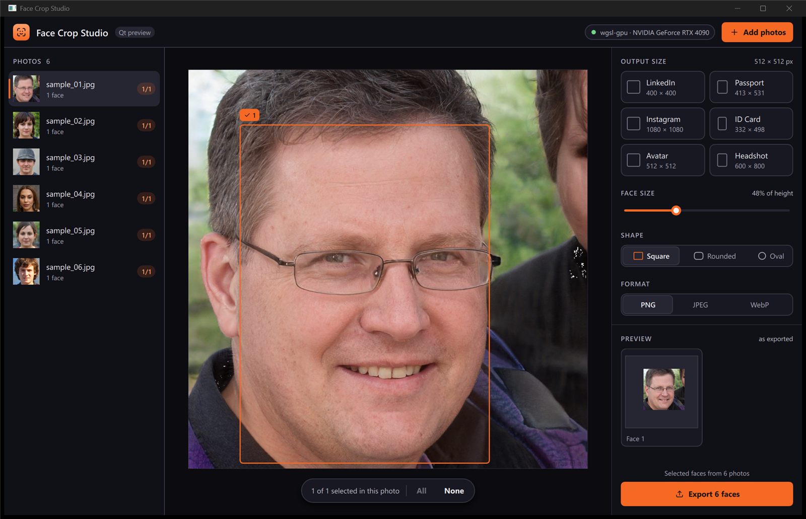

# fcs-qt: the desktop app

Face Crop Studio's desktop app, on Qt Quick/QML through
[Qt Bridge for Rust](https://doc.qt.io/qtbridge-rust/qtbridge/index.html) (`qtbridge` 0.4.1,
a Technology Preview). It started as an experiment beside the egui app (`fcs-gui`), shipped
beside it in 2.4.0 and replaced it in 3.0, keeping its models, pipeline and settings file. The
comparisons with fcs-gui below are from that period.



## What it does

- Add photos with the file dialog, by dropping files or folders on the window, or from the
  command line (`fcs-qt photo.jpg folder/`).
- Detection runs in the background, one photo at a time, on the same GPU/CPU detector and eye
  refiner as fcs-gui. The queue updates row by row.
- The photo shows its faces as boxes. The number chip (or Space) includes or skips a face; All
  / None act on the current photo.
- Face editing: click a box to make it active, then drag it or its handles to move and
  resize it, reset it to the detector's box, or delete it (Delete). The draw tool (D) adds a
  face the detector missed. Undo and redo (Ctrl+Z, Ctrl+Y) cover every edit of the photo.
- The canvas zooms with the mouse wheel or Ctrl +/-/0 and pans by dragging. Photos rotate in
  quarter turns or straighten by up to 45°; either finds the faces again on the turned photo,
  and previews and export use it too.
- The inspector has four tabs, as fcs-gui's settings do:
  - **Crop**: presets, fcs-gui's aspect-ratio picks (1:1, 4:5, 3:4) or a custom width and height, face size, position (center, thirds, or
    custom X/Y offsets), eye-line align, padding colour, crop overlay, EXIF orientation.
  - **Shape**: all eleven crop shapes, drawn from their real outlines, with their parameters,
    plus vignette.
  - **Enhance**: auto colour, red-eye removal, background blur, exposure, brightness,
    contrast, saturation, sharpness, skin smoothing.
  - **Output**: PNG, JPEG (with quality), WebP or AVIF; metadata (preserve the photo's EXIF,
    strip everything, or only the crop settings and quality metrics); fcs-gui's telemetry
    (stage timings in the log, at a chosen level).
- Each face's crop is outlined on the photo in the chosen shape. Previews are rendered
  through the real export path, so they show exactly what export writes.
- Export writes the selected faces of every photo to a folder, as `{stem}_face_NN.{ext}`. If
  any of those names already exist there, it asks first: keep both (the new crop gets a
  `(2)` suffix) or replace.
- Output options, as in fcs-gui and the CLI:
  - Quality rules: best face only, skip photos without a sharp face, a minimum quality, and
    quality suffixes in names. They judge the finished crop, as the CLI does.
  - The detection confidence floor; changing it finds the faces in every photo again.
  - An optional CSV or JSON report beside the crops, in fcs-gui's columns.
- The Photos tab's ⋯ menu saves the queue list (one path per line, as fcs-gui's) and, after an
  export, that export's report to any file (JSON for a `.json` name, CSV otherwise).
- Mapping files: a CSV, Excel, Parquet or SQLite table (opened from the Mapping tab, or
  dropped on the window) names each photo's crops. Its photo and name columns are guessed
  from the headers and can be changed. Rows match photos by file name, then by stem, exact
  case first, as in fcs-gui, and the tab shows how many matched.
- Camera: a live view over the canvas, optionally with faces found in every frame. The
  shutter (or Space) adds the frame to the photos, held in memory. From there it is edited,
  previewed and exported like any photo, and named `Camera N`.
- Paste (Ctrl+V, ⌘V on macOS) adds the clipboard's image the same way, named `Pasted N`. Qt
  reads the clipboard, so PNG-only copies from browsers work on Windows too.
- Backends, as in fcs-gui's GPU settings: WGSL on the GPU, experimental CUDA Rust (offered
  once the CUDA probe finds a device, behind fcs-gui's warning), or the CPU graph, plus
  "respect environment overrides". A switch loads the new engine in the background; the old
  one keeps working until it is up, and if it fails the setting reverts. Then every photo is
  detected again on the new backend.
- Photos can be removed from the queue one at a time, or all at once with a confirmation.
  An Activity tab logs what happened: detections, failures, exports, reports.
- Settings go to the same file as fcs-gui (`AppSettings::default_settings_path`). The header's
  ⋯ menu restores the defaults (after asking) and opens About, which names the Qt version
  for the LGPL notice.

Not ported: watch folders. fcs-cli has them (`--watch`); fcs-gui does not either.

Settings reach QML as one JSON object (`Studio.settings`, the serialized `AppSettings`), and
every control writes through one slot, `Studio.update(patch)`, which merges the patch, checks
it still deserializes, saves and re-renders. A new setting needs no Rust changes.

## Build and run

You need Qt 6.10 or newer (MSVC 64-bit kit) and the MSVC build tools: VS 2022 for Qt 6.12, as
CI uses (VS 2019 links Qt 6.10.3 fine, but stops at Qt 6.12's compiler check).

```powershell
./fcs-qt/dev.ps1 run                # or: test, clippy --all-targets, build --release
./fcs-qt/dev.ps1 run '--' samples   # photos queued; quote the --, PowerShell eats a bare one
```

HEIC and AVIF decoding need libheif and dav1d built for the dynamic CRT, once:

```powershell
C:\vcpkg\vcpkg.exe install "libheif[core,libde265]:x64-windows-static-md" "dav1d:x64-windows-static-md"
```

`[core]` leaves out the default features; `libde265` puts the HEVC decoder back. The other
default, `hevc`, is the x265 *encoder* (GPL-2.0), which decoding doesn't use. vcpkg ports from
before its 2026 libheif updates have no `libde265` feature (it was always built in): there,
use plain `libheif[core]`.

`dev.ps1` finds Qt (`$env:QT_DIR`, else the newest `%USERPROFILE%\Qt\6.*\msvc2022_64`), puts
its `bin` on PATH, sets `RUSTFLAGS`, and points `PKG_CONFIG_PATH` at the static-md triplet. The
crate is not a workspace member, because CI builds `--workspace` on runners without Qt.

Qt comes from `aqtinstall`. Qt 6.11.2 and later moved to a new repository layout that
aqtinstall 3.3.0, the latest release, cannot read; its main branch can, and both CI and local
builds install Qt 6.12.0 with it:
`uvx --from git+https://github.com/miurahr/aqtinstall.git@5a49f2b391ae8ee1d3c0dd87f8b33c1d49a4deb7 aqt install-qt windows desktop 6.12.0 win64_msvc2022_64 -O %USERPROFILE%\Qt`.
**Qt 6.12 needs Visual Studio 2022** (MSVC 19.30+) on Windows; with VS 2019 it stops at
`#error` in `qcompilerdetection.h`.

**Linux** (checked on Ubuntu 26.04, in WSL2 and on a GNOME 50 Wayland desktop, Qt 6.10.2 from
apt):

```bash
sudo apt install cmake libclang-dev pkg-config libdav1d-dev qt6-wayland \
  qt6-base-dev qt6-declarative-dev qt6-base-private-dev qt6-declarative-private-dev \
  qml6-module-qtquick-{controls,dialogs,layouts,shapes,effects}
```

libheif-sys needs libheif 1.23 or newer, and apt has 1.21, so build libde265 and libheif from
source with linux-build-deps' flags. Without sudo they go in `~/.local/fcs-native`:

```bash
prefix=~/.local/fcs-native; src=$(mktemp -d)
curl -fsSL https://github.com/strukturag/libde265/releases/download/v1.1.3/libde265-1.1.3.tar.gz | tar -xz -C "$src"
curl -fsSL https://github.com/strukturag/libheif/releases/download/v1.23.7/libheif-1.23.7.tar.gz | tar -xz -C "$src"
cmake -S "$src/libde265-1.1.3" -B "$src/de265" -DCMAKE_POLICY_VERSION_MINIMUM=3.5 \
  -DCMAKE_INSTALL_PREFIX="$prefix" -DCMAKE_INSTALL_LIBDIR=lib -DCMAKE_BUILD_TYPE=Release \
  -DBUILD_SHARED_LIBS=OFF -DENABLE_DECODER=ON -DENABLE_ENCODER=OFF -DENABLE_SDL=OFF
cmake --build "$src/de265" --parallel && cmake --install "$src/de265"
cmake -S "$src/libheif-1.23.7" -B "$src/heif" -DCMAKE_PREFIX_PATH="$prefix" \
  -DCMAKE_INSTALL_PREFIX="$prefix" -DCMAKE_INSTALL_LIBDIR=lib -DCMAKE_BUILD_TYPE=Release \
  -DBUILD_SHARED_LIBS=OFF -DWITH_EXAMPLES=OFF -DWITH_LIBDE265=ON -DWITH_X265=OFF \
  -DWITH_AOM_ENCODER=OFF -DWITH_AOM_DECODER=OFF -DENABLE_PLUGIN_LOADING=OFF -DWITH_LIBSHARPYUV=OFF
cmake --build "$src/heif" --parallel && cmake --install "$src/heif"

./fcs-qt/dev.sh run -- samples        # or: test, clippy --all-targets
```

The configure step should print `libde265 HEVC decoder : + built-in`. The models are not in
the repository: fetch them into `models/` from the release assets named by `SCRFD_URL` and
`EYE_REFINER_URL` in `.github/workflows/ci.yml`, and check them against the digests in
`models/README.md`. Without them the app runs but finds no faces.

`dev.sh` finds `qmake6` and links libheif statically with libde265, through the same
`SYSTEM_DEPS_LIBHEIF_*` variables as CI, from the first of `$FCS_NATIVE_PREFIX`, `/usr/local`
and `~/.local/fcs-native` that has `lib/libheif.a`. Run from a terminal inside a snap (VS
Code's snap, for one), it also drops the snap's GTK and GSettings variables: with them, Qt's
GTK3 platform theme starts the system GTK against the snap's schemas, and on GNOME 50 GTK
aborts at startup (`Settings schema 'org.gnome.settings-daemon.plugins.xsettings' does not
contain a key named 'antialiasing'`). Launching the built binary directly from such a terminal
needs the same: `env -u GSETTINGS_SCHEMA_DIR -u GTK_PATH ...`, or a terminal outside the snap.

## Packaging

```powershell
./fcs-qt/packaging/package.ps1     # Windows: fcs-qt/dist/face-crop-studio-qt-windows-x86_64 folder + .zip
```
```bash
./fcs-qt/packaging/package.sh      # Linux (x86_64, arm64): an AppImage and .deb; macOS: a .app and .dmg
```

Each does a release build and deploys Qt beside it: `windeployqt`, linuxdeploy with its Qt
plugin, or `macdeployqt`. The QML is compiled into the binary, so each deploy tool scans
`src/fcs_qt` for imports. Models go where `resolve_data_path` looks. Every package carries
`NOTICE-Qt.txt` (filled in with the Qt version), the LGPL-3.0 and GPL-3.0 texts, and Face Crop
Studio's own licences. `packaging/smoke.ps1` / `smoke.sh` run a package for 20 s with Qt off
PATH, from an empty folder. They check that it stayed up, loaded the detector from the package
and logged no QML or plugin errors. The fcs-qt workflow packages, smoke-tests and uploads all
three on every push (not on pull requests).

`package.sh` makes the macOS and Linux release assets: it also builds fcs-cli from the root
workspace and adds it, the samples and the README, under the names 2.x's packages had
(`face-crop-studio-<version>-<arch>.AppImage`/`.deb`, `face-crop-studio-<version>-aarch64-apple-darwin.dmg`
holding `Face Crop Studio.app`, bundle id `dev.facecropstudio.app`). The .deb is the
`face-crop-studio` package, under `/opt/face-crop-studio` with its own Qt, a `Depends` line from
`dpkg-shlibdeps`, and `fcs-qt`/`fcs-cli` linked into `/usr/bin`; it replaces 2.4's
`face-crop-studio-qt` preview package. The workflow installs it with apt and smoke-tests
`fcs-qt` from PATH, and runs `tools/verify_package.zig` on both packages' fcs-cli. The .dmg's
volume is labelled a macOS preview until the app is checked on a real Mac.

Windows: `release.yml` takes `package.ps1`'s folder from `qt.yml` (artifact
`qt-windows-payload`), adds fcs-cli.exe (static CRT, built there), the samples and README, and
builds the zip, MSI (`installer/windows/wix/Product.wxs`), setup.exe
(`installer/windows/face-crop-studio.nsi`) and MSIX (`installer/windows/msix/build_msix.ps1`)
from it. All three installers keep 2.x's install directory, registry keys, MSI upgrade code and
Store identity, so they upgrade a 2.x install in place. On every push the fcs-qt workflow builds
the MSI, setup.exe and MSIX from fcs-qt's folder alone and installs, runs and removes each; the
MSIX is signed there with a throwaway certificate, and the Store re-signs real uploads.

Signing: the release builds sign only when the repository has certificates (`CODE_SIGN_PFX`,
`APPLE_DEVELOPER_ID_*`), and it has none yet, so the .exe and MSI are unsigned and the .app is
signed ad hoc. The macOS path (`package.sh` with `APPLE_DEVELOPER_ID_NAME`, the certificate
imported in `qt.yml` on release runs) is untested; when certificates arrive, check whether the
hardened runtime needs `com.apple.security.cs.allow-jit` for the QML engine.

Tests beyond `cargo test`: `tests/qml/run.sh` runs the screens under `qmltestrunner` against a
mock Studio serving the real factory settings (`tests/qml/fixture.js`, which a Rust test keeps
current), on the Linux leg. `packaging/e2e.ps1` drives the packaged Windows app through UI
Automation: six photos, every face found and exported through the real folder dialog, then a
clean shutdown.

Releases: `release.yml` runs `qt.yml` with `release: true` (`qt-release`), and its publish job
waits for it and attaches the macOS and Linux assets and their `SHA256SUMS-<platform>.txt`.
Package names carry the workspace version (a release tag's, for an rc); the About box shows
the workspace version.

Icons: the .exe embeds `assets/app_icon.ico` (build.rs), every window gets it at startup
(`images::install_app_icon`, which also serves it to the header), the .app gets an `.icns` made from `app_logo.svg`, and the Linux
packages a 256 px PNG of it.

## Findings

**Works well**

- The bridge is genuinely small to use. One `#[qobject(Singleton)]` impl with `qproperty!`,
  `#[qslot]` and `#[qsignal]` is the whole Rust/QML boundary. `src/studio.rs` holds all the
  app state; QML only renders it and calls slots.
- Background work is easy: `get_thread_handle()` plus `invoke_mut` brings a worker thread's
  result back onto the Qt thread with `&mut self`. Detection, previews and export all use it.
- `Vec<serde_json::Value>` properties give QML plain arrays of objects, enough for every list
  here.
- QML makes a modern, animated, accessible UI cheap: about 1,400 lines of QML and 1,250 of
  Rust for this screen.
- Detection and export reuse fcs-core/fcs-utils unchanged. The only shared-code changes are
  `fcs_core::apply_preset` (moved out of the egui inspector so both front ends agree) and
  `ImageFormatHint::extension`.

**Rough edges**

- **The CRT.** The workspace's `.cargo/config.toml` links the static CRT (`+crt-static`), but
  Qt uses the dynamic one. Mixing them risks one heap freeing another's memory. A nested config
  cannot undo it, because rustc lets `+crt-static` win over a later `-crt-static`. Only
  `RUSTFLAGS` can override it, so `dev.ps1` sets it and `build.rs` refuses to build otherwise.
  The C libraries have to match too: the workspace's libheif and dav1d come from vcpkg's
  `x64-windows-static` triplet (static CRT), so fcs-qt uses `x64-windows-static-md` (static
  libraries on the dynamic CRT); see the vcpkg line below.
- **libheif loads DLLs from `C:\`.** vcpkg builds libheif with an empty plugin directory,
  so on Windows `heif_init` calls `LoadLibrary` on every `*.dll` in the root of the current
  drive. All three binaries now set `LIBHEIF_PLUGIN_PATH` to a folder next to the exe before
  anything starts (`fcs_utils::process_env::confine_libheif_plugins`). It has to go through the
  CRT's `_wputenv_s`: libheif and Qt read variables with `getenv`, which never sees
  `std::env::set_var`.
- **No image provider.** QML's `Image` loads only URLs, and the bridge has no way to register
  a `QQuickImageProvider`. fcs-qt adds one itself: [cpp/image_provider.cpp](cpp/image_provider.cpp)
  (about 60 lines, compiled by `build.rs` through `qt-build-utils`) serves `image://fcs/<key>`
  from an in-memory store in [src/images.rs](src/images.rs). It gets the engine through the
  bridge's doc-hidden `QApp::qml_engine()`, which a later bridge release could change. The
  store holds a thumbnail per photo, canvas copies of the 8 most recent photos, and the
  previews on screen. Nothing goes through the disk. The file also holds the other Qt calls
  with no C entry point (`QClipboard::image`, `setWindowIcon`). It cannot become Rust or Zig:
  both speak the C ABI, and overriding a C++ virtual means building a vtable per compiler ABI
  (MSVC's differs from GCC/Clang's). What Qt does export as C is called from Rust directly
  (`qVersion`, since 2026-11-15).
- **Models are awkward.** `QListModel` exists but is a separate QObject with little
  documentation. Here QML mirrors the queue array into a `ListModel` with `set()`/`append()`,
  which keeps the list from resetting on each update.
- **Packaging** (2026-11-14):
  - **qtbridge is LGPL-3.0 and statically linked.** Qt's own libraries ship as replaceable
    shared libraries, but the qtbridge crates (`LicenseRef-Qt-Commercial OR LGPL-3.0-only`)
    are compiled into the binary. LGPLv3 then requires that users can relink, which Face Crop
    Studio meets by being open source. Packages must still carry the licence texts and point
    to the exact source, which `NOTICE-Qt.txt` does. Not legal advice; worth a proper check
    before a release.
  - **windeployqt ships a 2013 `d3dcompiler_47.dll`** (Windows 8.1's) unless told not to.
    Next to the exe it shadows Windows' current copy, and wgpu's DX12 backend then fails to
    compile its shaders (`unrecognized compiler target 'cs_5_1'`). Detection silently fell
    back to Vulkan here, and would fall back to the CPU on machines without Vulkan.
    `--no-system-d3d-compiler` fixes it; Qt Quick doesn't need it either.
  - **The MSVC runtime is now a dependency.** fcs-gui links the CRT statically; fcs-qt can't,
    because Qt doesn't. The package copies the VS 2022 runtime DLLs next to the exe (14.44 from
    the local VS 2022 Build Tools, 2026-11-14). VS 2019's are too old for Qt's MSVC 2022
    binaries, so a machine without VS 2022 skips them and relies on the installed VC++
    redistributable.
  - Sizes (CI artifacts, Qt 6.12): Windows zip 48 MB (113 MB unpacked), Linux AppImage 61 MB,
    macOS dmg 79 MB.
  - **macdeployqt copies Qt's SQL drivers.** Their ODBC/PostgreSQL/Mimer client libraries
    can't be bundled, which left references into Homebrew; `package.sh` deletes them.
  - **libheif and dav1d are static on macOS too.** Homebrew's libheif loaded from
    `/opt/homebrew` by absolute path and links x265 (GPL-2.0), which macdeployqt bundled.
    fcs-gui's release had the same Homebrew dependency without bundling anything. Both now
    use `.github/actions/macos-build-deps` (PR #13), which builds dav1d, libde265 and libheif
    from source with every other codec off.
  - All three packages pass the smoke test in CI: the detector loads from the package (CPU on
    the Linux runner, which has no GPU), with no QML or plugin errors.

- **Windows, Linux and macOS.** Face Crop Studio ships on all three. On Linux
  (2026-11-13, Ubuntu 26.04 in WSL2) fcs-qt builds with no code changes, its 11 tests pass
  (HEIC and AVIF included), clippy is clean, and the app runs under WSLg: photos load, faces
  are detected, previews render. The Linux-specific work was all in the build:
  - qtbridge includes Qt's **private headers** (`private/qobject_p.h`, `private/qqmldata_p.h`),
    so it needs `qt6-*-private-dev`. Private headers carry no compatibility promise, so a build
    is tied to the exact Qt version it was compiled against, which affects any distro package
    or bundle.
  - Qt 6.10 comes from apt only on Ubuntu 26.04 / Fedora 43 and later. CI's `ubuntu-22.04`
    runners would need Qt from aqtinstall or the online installer.
  - CMake 4 (Ubuntu 26.04) refuses libde265 1.0.15's CMakeLists without
    `-DCMAKE_POLICY_VERSION_MINIMUM=3.5`, which linux-build-deps will also need on a newer
    runner.
  - With a distro `libheif-dev` installed, the link picks its shared libheif (HEVC decode is a
    separate plugin package) over the static one in `/usr/local`. A libheif built where
    libwebp's sharpyuv is present needs `-DWITH_LIBSHARPYUV=OFF` or an extra link library.
  - The webcam crate's bindgen needs `libclang-dev`, which CI runners have but a bare
    system doesn't.

  Qt 6.12.0 (aqtinstall's build, in WSL) works the same: tests pass and the app runs, with
  qtbridge 0.4.1 compiled against 6.12's private headers.

  macOS: the first CI run (Qt 6.10.3) failed inside Qt. On arm64, `qyieldcpu.h` calls
  `__yield()` without declaring it, and the runner's Xcode clang rejects that. Qt 6.12 uses
  `__builtin_arm_yield` instead, which is why CI moved to 6.12.

  On a real desktop (2026-11-16, Ubuntu 26.04, GNOME 50 on Wayland, GTX 1080 Ti on driver
  580): faces are detected on the GPU (WGSL on Vulkan, 8 ms against the CPU graph's 18), and
  the camera opens, shows faces live and adds frames. CUDA is offered only from compute
  capability 8.0, so a Pascal card shows it greyed out with that reason, as intended. That
  desktop also found a crash on close, about one in four: the detection workers, woken by
  the closed job channel, dropped the last handle on the engine and destroyed the Vulkan
  device while the main thread was in `exit`, racing NVIDIA's driver teardown (`free():
  invalid pointer` or a segfault in libnvidia-glcore). The Studio now leaks the engine on
  drop; 20 closes in a row under gdb were clean. Closing while an engine was loading, or the
  CUDA probe was running, crashed 11 times in 12 (a gdb breakpoint on `Engine::load` quit
  the app): the loader dropped its unwanted engine, or was still creating its Vulkan
  instance, during `exit`. Those threads now hold a lock the Studio's drop waits for; 20 in a
  row were clean.

  Not checked on Linux: the file and folder dialogs (Qt Quick's own, non-native, unless a
  platform theme provides one). qtbridge calls macOS (arm64) experimental.

**Before fcs-qt could replace fcs-gui** (agreed 2026-11-13: keep both until then), in order:

1. ~~CI on all three platforms~~: done 2026-11-14 (`.github/workflows/qt.yml`, Qt 6.12).
2. ~~Packaging on all three~~: done 2026-11-14. Portable packages with Qt and the LGPL notices,
   an MSI and a .deb (see Packaging). Signing waits for step 5; NSIS and MSIX are not planned
   for the preview.
3. ~~The fcs-gui features still missing~~: done 2026-11-14 (clipboard paste, the queue list,
   after-the-fact reports, aspect-ratio picks, metadata, telemetry, restoring defaults, About).
   Deliberate differences: settings save on every change, so there is no Save Settings; and
   Restore defaults resets to the factory settings, where fcs-gui's returns to the settings it
   launched with (or "Set as Default"'s in-memory copy).
4. ~~A batch-performance comparison against fcs-gui~~: done 2026-11-14, release builds on
   Windows (Ryzen 9 7950X, RTX 4090, wgsl-gpu), same settings file, timed from the first to
   the last moment either app was busy:

   | | fcs-qt before | fcs-qt now | fcs-gui |
   |---|---|---|---|
   | 1,000 Open Images photos (888 crops) | never finished: window hung 15+ min | 6.4 s finding faces + 5.9 s export | 9.0 s batch export |
   | 8 camera RAW files (5 crops) | 10.2 s + 8.5 s | 5.0 s + 3.6 s | 4.4 s |
   | Peak memory, 1,000 photos / RAW | — | 0.8 GB / 2.9 GB | 0.7 GB / 3.9 GB |

   Two fixes came out of it. The queue went to QML whole after every detection, and QML takes
   it in at a cost proportional to its length, so a batch was quadratic: 170 ms a photo at 200
   photos. Single photos now go as a row update (`queueRowChanged`, `queueRowRemoved`). And
   detection and export ran on one thread; they now use fcs-gui's batch worker count (half
   the cores, at most 4). fcs-qt still does more work in all, because it decodes each photo
   twice (to find faces as photos arrive, then to export), but the export itself is quicker
   since the faces are already found. The window answers within 20 ms throughout, apart from
   about 0.5 s while 1,000 photos are first added to the list.
5. ~~One release shipping both front ends before deciding~~: 2.4.0, 2026-11-15. Dropping egui
   would be the UI overhaul the 3.0 version is reserved for.
6. The gaps fcs-gui still covered (closed 2026-11-15 unless noted): Linux arm64 packages; the
   setup.exe and MSIX built from fcs-qt and install-tested in CI (see Packaging); Qt Quick
   tests and a Windows end-to-end test (see Tests). Then two weeks of 2.4.0 with no issue
   raised, and the file dialogs checked on a real Linux desktop (2026-11-21; its camera and GPU
   2026-11-16). No real Mac is available, so (decided 2026-11-17) 3.0 ships fcs-qt on macOS
   labelled as a preview until someone checks it on real hardware.
7. ~~3.0~~: done 2026-11-27. fcs-cli and fcs-qt as the Windows payload of the zip, MSI,
   setup.exe and MSIX (fcs-qt's own MSI gone, the shared one keeps fcs-gui's upgrade code),
   fcs-qt's packages on macOS and Linux under fcs-gui's names (macOS marked as a preview), and
   fcs-gui removed.

Also worth asking upstream for an image provider API in the bridge, so the C++ file can go.
