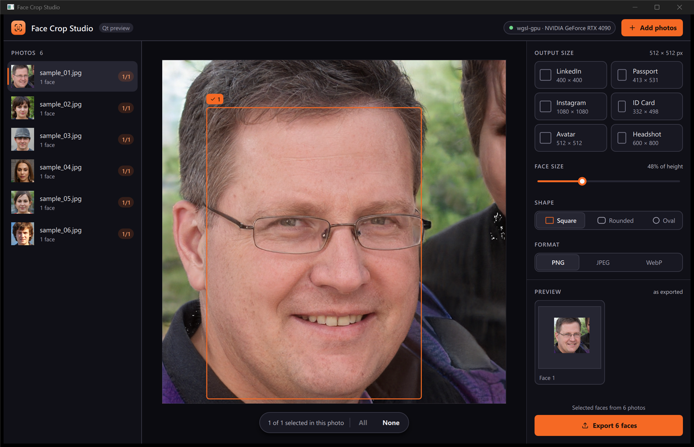

# fcs-qt: a Qt Quick front end (experiment)

Face Crop Studio's core workflow on Qt Quick/QML through
[Qt Bridge for Rust](https://doc.qt.io/qtbridge-rust/qtbridge/index.html) (`qtbridge` 0.4.1,
a Technology Preview). It sits beside the egui app (`fcs-gui`) and uses the same models,
pipeline and settings file.



## What it does

- Add photos with the file dialog, by dropping files or folders on the window, or from the
  command line (`fcs-qt photo.jpg folder/`).
- Detection runs in the background, one photo at a time, on the same GPU/CPU detector and eye
  refiner as fcs-gui. The queue updates row by row.
- The photo shows its faces as boxes. The number chip (or Space) includes or skips a face; All
  / None act on the current photo.
- Face editing: click a box to make it active, then drag it or its handles to move and
  resize it, reset it to the detector's box, or delete it (Delete). The draw tool (D) adds a
  face the detector missed. Undo and redo (Ctrl+Z, Ctrl+Y) cover every edit of the photo.
- The canvas zooms with the mouse wheel or Ctrl +/-/0 and pans by dragging. Photos rotate in
  quarter turns or straighten by up to 45°; either finds the faces again on the turned photo,
  and previews and export use it too.
- The inspector has four tabs, as fcs-gui's settings do:
  - **Crop**: presets or a custom width and height, face size, position (center, thirds, or
    custom X/Y offsets), eye-line align, padding colour, crop overlay, EXIF orientation.
  - **Shape**: all eleven crop shapes, drawn from their real outlines, with their parameters,
    plus vignette.
  - **Enhance**: auto colour, red-eye removal, background blur, exposure, brightness,
    contrast, saturation, sharpness, skin smoothing.
  - **Output**: PNG, JPEG (with quality), WebP or AVIF.
- Each face's crop is outlined on the photo in the chosen shape. Previews are rendered
  through the real export path, so they show exactly what export writes.
- Export writes the selected faces of every photo to a folder, as `{stem}_face_NN.{ext}`. If
  any of those names already exist there, it asks first: keep both (the new crop gets a
  `(2)` suffix) or replace.
- Output options, as in fcs-gui and the CLI:
  - Quality rules: best face only, skip photos without a sharp face, a minimum quality, and
    quality suffixes in names. They judge the finished crop, as the CLI does.
  - The detection confidence floor; changing it finds the faces in every photo again.
  - An optional CSV or JSON report beside the crops, in fcs-gui's columns.
- Mapping files: a CSV, Excel, Parquet or SQLite table (opened from the Mapping tab, or
  dropped on the window) names each photo's crops. Its photo and name columns are guessed
  from the headers and can be changed. Rows match photos by file name, then by stem, exact
  case first, as in fcs-gui, and the tab shows how many matched.
- Camera: a live view over the canvas, optionally with faces found in every frame. The
  shutter (or Space) adds the frame to the photos, held in memory. From there it is edited,
  previewed and exported like any photo, and named `Camera N`.
- Backends, as in fcs-gui's GPU settings: WGSL on the GPU, experimental CUDA Rust (offered
  once the CUDA probe finds a device, behind fcs-gui's warning), or the CPU graph, plus
  "respect environment overrides". A switch loads the new engine in the background; the old
  one keeps working until it is up, and if it fails the setting reverts. Then every photo is
  detected again on the new backend.
- Photos can be removed from the queue one at a time, or all at once with a confirmation.
  An Activity tab logs what happened: detections, failures, exports, reports.
- Settings go to the same file as fcs-gui (`AppSettings::default_settings_path`).

Not ported: watch folders. fcs-cli has them (`--watch`); fcs-gui does not either.

Settings reach QML as one JSON object (`Studio.settings`, the serialized `AppSettings`), and
every control writes through one slot, `Studio.update(patch)`, which merges the patch, checks
it still deserializes, saves and re-renders. A new setting needs no Rust changes.

## Build and run

You need Qt 6.10 or newer (MSVC 64-bit kit) and the MSVC build tools. VS 2019 Build Tools link
against the prebuilt Qt 6.10.3 MSVC 2022 binaries without trouble; Qt 6.12 needs VS 2022.

```powershell
./fcs-qt/dev.ps1 run                # or: test, clippy --all-targets, build --release
./fcs-qt/dev.ps1 run '--' samples   # photos queued; quote the --, PowerShell eats a bare one
```

HEIC and AVIF decoding need libheif and dav1d built for the dynamic CRT, once:

```powershell
C:\vcpkg\vcpkg.exe install "libheif[core,libde265]:x64-windows-static-md" "dav1d:x64-windows-static-md"
```

`[core]` leaves out the default features; `libde265` puts the HEVC decoder back. The other
default, `hevc`, is the x265 *encoder* (GPL-2.0), which decoding doesn't use. vcpkg ports from
before its 2026 libheif updates have no `libde265` feature (it was always built in): there,
use plain `libheif[core]`.

`dev.ps1` finds Qt (`$env:QT_DIR`, else the newest `%USERPROFILE%\Qt\6.*\msvc2022_64`), puts
its `bin` on PATH, sets `RUSTFLAGS`, and points `PKG_CONFIG_PATH` at the static-md triplet. The
crate is not a workspace member, because CI builds `--workspace` on runners without Qt.

Qt came from `aqtinstall` (`aqt install-qt windows desktop 6.10.3 win64_msvc2022_64`). Qt 6.11.2
and later moved to a new repository layout that aqtinstall 3.3.0, the latest release, cannot
read. Its main branch can (`pip install git+https://github.com/miurahr/aqtinstall.git`), and CI
installs Qt 6.12.0 that way. **Qt 6.12 needs Visual Studio 2022** (MSVC 19.30+) on Windows;
with VS 2019 it stops at `#error` in `qcompilerdetection.h`, so local Windows builds stay on
6.10.3 until VS 2022 is installed.

**Linux** (checked on Ubuntu 26.04 in WSL2, Qt 6.10.2 from apt):

```bash
sudo apt install cmake libclang-dev qt6-base-dev qt6-declarative-dev \
  qt6-base-private-dev qt6-declarative-private-dev \
  qml6-module-qtquick-{controls,dialogs,layouts,shapes,effects}
# then libde265 + libheif built into /usr/local, as .github/actions/linux-build-deps does
./fcs-qt/dev.sh run -- samples        # or: test, clippy --all-targets
```

`dev.sh` finds `qmake6` and, when `/usr/local/lib/libheif.a` exists, links it statically
with libde265 using the same `SYSTEM_DEPS_LIBHEIF_*` variables as CI.

## Packaging

```powershell
./fcs-qt/packaging/package.ps1     # Windows: fcs-qt/dist/fcs-qt-windows-x86_64 folder + .zip
```
```bash
./fcs-qt/packaging/package.sh      # Linux: an AppImage; macOS: a .app and .dmg
```

Each does a release build and deploys Qt beside it: `windeployqt`, linuxdeploy with its Qt
plugin, or `macdeployqt`. The QML is compiled into the binary, so each deploy tool scans
`src/fcs_qt` for imports. Models go where `resolve_data_path` looks, as in fcs-gui's
packages. Every package carries `NOTICE-Qt.txt` (filled in with the Qt version), the LGPL-3.0
and GPL-3.0 texts, and Face Crop Studio's own licences. `packaging/smoke.ps1` / `smoke.sh` run
a package for 20 s with Qt off PATH, from an empty folder. They check that it stayed up,
loaded the detector from the package and logged no QML or plugin errors. The fcs-qt
workflow packages, smoke-tests and uploads all three on every push (not on pull requests).

These are portable packages, not installers. The NSIS/MSI/MSIX, .deb and signed .dmg in
`installer/` are still fcs-gui only.

## Findings

**Works well**

- The bridge is genuinely small to use. One `#[qobject(Singleton)]` impl with `qproperty!`,
  `#[qslot]` and `#[qsignal]` is the whole Rust/QML boundary. `src/studio.rs` holds all the
  app state; QML only renders it and calls slots.
- Background work is easy: `get_thread_handle()` plus `invoke_mut` brings a worker thread's
  result back onto the Qt thread with `&mut self`. Detection, previews and export all use it.
- `Vec<serde_json::Value>` properties give QML plain arrays of objects, enough for every list
  here.
- QML makes a modern, animated, accessible UI cheap: about 1,400 lines of QML and 1,250 of
  Rust for this screen.
- Detection and export reuse fcs-core/fcs-utils unchanged. The only shared-code changes are
  `fcs_core::apply_preset` (moved out of the egui inspector so both front ends agree) and
  `ImageFormatHint::extension`.

**Rough edges**

- **The CRT.** The workspace's `.cargo/config.toml` links the static CRT (`+crt-static`), but
  Qt uses the dynamic one. Mixing them risks one heap freeing another's memory. A nested config
  cannot undo it, because rustc lets `+crt-static` win over a later `-crt-static`. Only
  `RUSTFLAGS` can override it, so `dev.ps1` sets it and `build.rs` refuses to build otherwise.
  The C libraries have to match too: the workspace's libheif and dav1d come from vcpkg's
  `x64-windows-static` triplet (static CRT), so fcs-qt uses `x64-windows-static-md` (static
  libraries on the dynamic CRT); see the vcpkg line below.
- **libheif loads DLLs from `C:\`.** vcpkg builds libheif with an empty plugin directory,
  so on Windows `heif_init` calls `LoadLibrary` on every `*.dll` in the root of the current
  drive. All three binaries now set `LIBHEIF_PLUGIN_PATH` to a folder next to the exe before
  anything starts (`fcs_utils::process_env::confine_libheif_plugins`). It has to go through the
  CRT's `_wputenv_s`: libheif and Qt read variables with `getenv`, which never sees
  `std::env::set_var`.
- **No image provider.** QML's `Image` loads only URLs, and the bridge has no way to register
  a `QQuickImageProvider`. fcs-qt adds one itself: [cpp/image_provider.cpp](cpp/image_provider.cpp)
  (about 60 lines, compiled by `build.rs` through `qt-build-utils`) serves `image://fcs/<key>`
  from an in-memory store in [src/images.rs](src/images.rs). It gets the engine through the
  bridge's doc-hidden `QApp::qml_engine()`, which a later bridge release could change. The
  store holds a thumbnail per photo, canvas copies of the 8 most recent photos, and the
  previews on screen. Nothing goes through the disk.
- **Models are awkward.** `QListModel` exists but is a separate QObject with little
  documentation. Here QML mirrors the queue array into a `ListModel` with `set()`/`append()`,
  which keeps the list from resetting on each update.
- **Packaging** (2026-11-14):
  - **qtbridge is LGPL-3.0 and statically linked.** Qt's own libraries ship as replaceable
    shared libraries, but the qtbridge crates (`LicenseRef-Qt-Commercial OR LGPL-3.0-only`)
    are compiled into the binary. LGPLv3 then requires that users can relink, which Face Crop
    Studio meets by being open source. Packages must still carry the licence texts and point
    to the exact source, which `NOTICE-Qt.txt` does. Not legal advice; worth a proper check
    before a release.
  - **windeployqt ships a 2013 `d3dcompiler_47.dll`** (Windows 8.1's) unless told not to.
    Next to the exe it shadows Windows' current copy, and wgpu's DX12 backend then fails to
    compile its shaders (`unrecognized compiler target 'cs_5_1'`). Detection silently fell
    back to Vulkan here, and would fall back to the CPU on machines without Vulkan.
    `--no-system-d3d-compiler` fixes it; Qt Quick doesn't need it either.
  - **The MSVC runtime is now a dependency.** fcs-gui links the CRT statically; fcs-qt can't,
    because Qt doesn't. The package copies the VS 2022 runtime DLLs next to the exe. VS 2019's
    are too old for Qt's MSVC 2022 binaries, so a local build without VS 2022 skips them and
    relies on the installed VC++ redistributable.
  - Sizes (CI artifacts, Qt 6.12): Windows zip 48 MB (113 MB unpacked), Linux AppImage 61 MB,
    macOS dmg 79 MB.
  - **macdeployqt copies Qt's SQL drivers.** Their ODBC/PostgreSQL/Mimer client libraries
    can't be bundled, which left references into Homebrew; `package.sh` deletes them. It did
    bundle Homebrew's libheif and dav1d correctly, with no Homebrew paths left in the bundle.
  - **The shipped fcs-gui bundle probably needs Homebrew.** fcs-qt's build log shows the
    release binary loading `/opt/homebrew/opt/libheif/lib/libheif.1.dylib` and `libdav1d.7.dylib`
    by absolute path. fcs-gui links the same libraries the same way, and `build_macos.sh`
    copies no dylibs into the `.app`. So the current fcs-gui release very likely fails to start
    on a Mac without `brew install libheif dav1d`. Not yet confirmed on a clean Mac, and not
    fixed here.
  - All three packages pass the smoke test in CI: the detector loads from the package (CPU on
    the Linux runner, which has no GPU), with no QML or plugin errors.

- **Windows, Linux and macOS.** Face Crop Studio ships on all three. On Linux
  (2026-11-13, Ubuntu 26.04 in WSL2) fcs-qt builds with no code changes, its 11 tests pass
  (HEIC and AVIF included), clippy is clean, and the app runs under WSLg: photos load, faces
  are detected, previews render. The Linux-specific work was all in the build:
  - qtbridge includes Qt's **private headers** (`private/qobject_p.h`, `private/qqmldata_p.h`),
    so it needs `qt6-*-private-dev`. Private headers carry no compatibility promise, so a build
    is tied to the exact Qt version it was compiled against, which affects any distro package
    or bundle.
  - Qt 6.10 comes from apt only on Ubuntu 26.04 / Fedora 43 and later. CI's `ubuntu-22.04`
    runners would need Qt from aqtinstall or the online installer.
  - CMake 4 (Ubuntu 26.04) refuses libde265 1.0.15's CMakeLists without
    `-DCMAKE_POLICY_VERSION_MINIMUM=3.5`, which linux-build-deps will also need on a newer
    runner.
  - With a distro `libheif-dev` installed, the link picks its shared libheif (HEVC decode is a
    separate plugin package) over the static one in `/usr/local`. A libheif built where
    libwebp's sharpyuv is present needs `-DWITH_LIBSHARPYUV=OFF` or an extra link library.
  - The webcam crate's bindgen needs `libclang-dev`, which CI runners have but a bare
    system doesn't.

  Qt 6.12.0 (aqtinstall's build, in WSL) works the same: tests pass and the app runs, with
  qtbridge 0.4.1 compiled against 6.12's private headers.

  macOS: the first CI run (Qt 6.10.3) failed inside Qt. On arm64, `qyieldcpu.h` calls
  `__yield()` without declaring it, and the runner's Xcode clang rejects that. Qt 6.12 uses
  `__builtin_arm_yield` instead, which is why CI moved to 6.12.

  Not checked on Linux: the file and folder dialogs (Qt Quick's own, non-native, unless a
  platform theme provides one), the camera (no webcam in WSL), and a real GPU (WSL's Vulkan
  is llvmpipe). qtbridge calls macOS (arm64) experimental.

**Before fcs-qt could replace fcs-gui** (agreed 2026-11-13: keep both until then), in order:

1. ~~CI on all three platforms~~: done 2026-11-14 (`.github/workflows/qt.yml`, Qt 6.12).
2. Packaging on all three: portable packages with Qt deployed and LGPL notices are done (see
   Packaging); the existing installers built from them are not.
3. The fcs-gui features still missing: clipboard paste, queue list and after-the-fact
   reports, aspect-ratio picks, metadata settings, telemetry and log level, settings
   save/restore/defaults, About.
4. A batch-performance comparison against fcs-gui (large queues, camera RAW files).
5. One release shipping both front ends before deciding; dropping egui would be the UI
   overhaul the 3.0 version is reserved for.

Also worth asking upstream for an image provider API in the bridge, so the C++ file can go.
